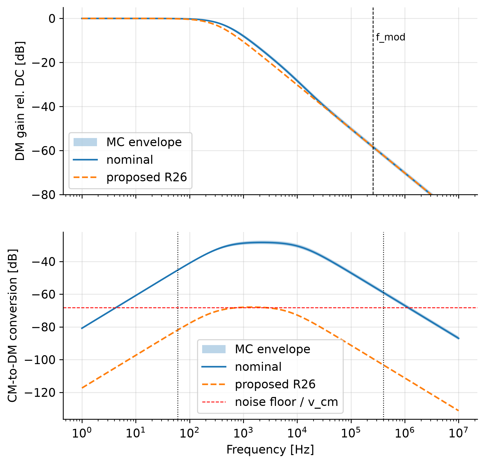
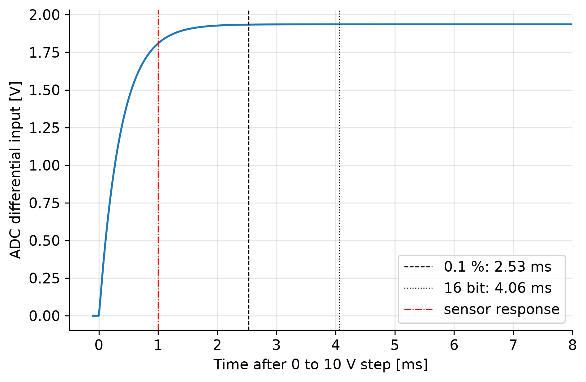
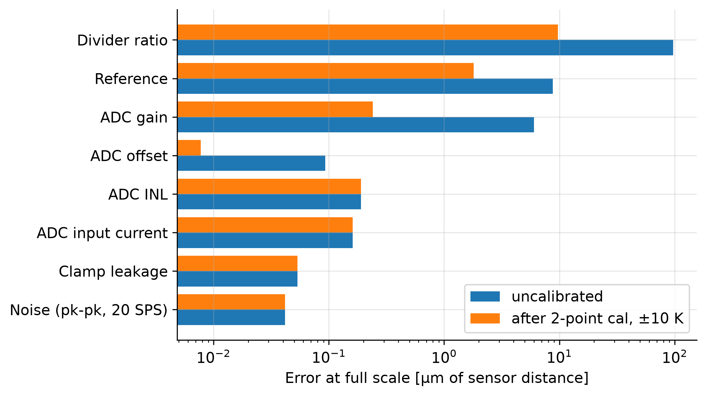

# 01: Prox input filter

**Domain:** electrical
**Tool(s):** ngspice 47, Python 3.13 (numpy / matplotlib / spicelib)
**Owner:** [@Mthanson1](https://github.com/Mthanson1)
**Status:** in progress

## Goal
Check the inductive-proximity sensor channel on the ADAM Calibration Board V2 (schematic sheets
4 and 7). The chain is 7.5k/1.8k divider → 1 kΩ Rs → Ccm/Cdiff → ADS1220. This study checks:

1. **Anti-aliasing (sim 1):** attenuation at the ADS1220 modulator frequency (256 kHz) is
   **≥ 50 dB** across component tolerances.
2. **CM-to-DM conversion (sim 1):** a 10 mV common-mode disturbance between the sensor return
   and ADC ground converts to less differential signal than the ADC noise (3.89 µVrms).
   That puts the limit at **≤ −68.2 dB**. It is checked at 60 Hz, where the ADC's 20 SPS
   50/60 Hz notch gets credit, and at 400 kHz, the buck frequency, where the analog filter
   gets no help.
3. **Settling (sim 2):** time to settle after a 0 → 10 V sensor step (informational).
4. **DC error budget (analysis 11):** full-scale error in µm of sensor distance, before and
   after a two-point calibration, plus ADC input-range headroom.

## Setup
- Model files:
  - [`model/prox_filter.inc`](model/prox_filter.inc): one channel (CH0) as a subcircuit. It
    uses R13, R14, R25, R26, C28, C29 and C32 from
    [`shared/board/adam_cal_v2.csv`](../../shared/board/adam_cal_v2.csv).
  - [`model/ac_mc.cir`](model/ac_mc.cir): two copies of the channel, one driven
    differentially and one by a ground offset.
  - [`model/step.cir`](model/step.cir): 0 → 10 V step.
- Monte Carlo: 500 runs, each part uniform within its tolerance. That is ±1 % for the
  divider, ±0.1 % for Rs, ±2 % for Ccm (C0G) and ±10 % for Cdiff (assumed).
- ADC settings for the noise and error terms: normal mode, 20 SPS, gain 1, **PGA bypassed**.
  The bypass is required because AINN sits at AVSS (V_SENSE− is GND). Datasheet values with
  table and page references are in [`inputs/ads1220.csv`](inputs/ads1220.csv).
- Criteria and assumptions: [`inputs/criteria.csv`](inputs/criteria.csv).

## Assumptions
- The sensor output is an ideal voltage source. The sensor return equals board GND at the connector.
- The ADS1220 inputs are modeled as 5 pF each. The input current (≤ 15 nA, read from the
  axis limits of datasheet Fig 6-21 to 6-24) and the BAV199 leakage (5 nA) only enter the
  error budget. The clamp diodes' ~2 pF is negligible next to 10 nF.
- The noise tables were measured at AVDD = 3.3 V. This board runs the prox ADC at 5 V.
- The sensor is linear at 10 V over 6 mm (1.67 V/mm). That is the schematic's nominal range;
  the slope is not from a datasheet.
- The divider resistors are 1 % thick film at 100 ppm/K, with no tracking. The lab temperature
  changes by ±10 K between calibration and use.
- **The 5 µm post-calibration limit is provisional.** Replace it with the ADAM accuracy
  requirement.

## How to reproduce
From the repo root with the venv active and ngspice installed (see the top-level README):

```powershell
python electrical/01-prox-input-filter/scripts/run_sims.py      # sims 1 + 2, ~1 min
python electrical/01-prox-input-filter/scripts/error_budget.py  # analysis 11
```

Each script prints a pass/fail table and writes it to `results/summary_*.csv` (not committed).
Each exits non-zero if any criterion fails.

## Results


| Criterion | Result | Limit | |
|---|---|---|---|
| DM −3 dB corner (nominal / MC range) | 435 Hz / 397–480 Hz | n/a | info |
| Attenuation at 256 kHz, MC worst | 57.4 dB | ≥ 50 dB | **PASS** |
| CM-to-DM at 400 kHz, nominal / MC worst | −59.0 / −57.8 dB | ≤ −68.2 dB | **FAIL** |
| CM-to-DM at 60 Hz, analog only / with 20 SPS notch | −44.9 / −134.9 dB | ≤ −68.2 dB | **PASS** |
| Settling to 0.1 % / 16 bit | 2.53 / 4.06 ms | n/a | info |

The corner is 435 Hz, not the 461 Hz hand calc. The hand calc ignores the two Ccm, which add
Ccm/2 = 5 nF in parallel with Cdiff. Settling is slower than the sensor's 1 ms response.
That is fine for static calibration, but it would limit a dynamic measurement.

**The CM conversion comes from the circuit's asymmetry, not from part tolerances.** The divider
puts R13‖R14 = 1.45 kΩ in series with the + leg only. Moving each part to its tolerance limit
shifts the 400 kHz conversion by less than 1 dB, so tighter Ccm matching would not help.
Balancing the − leg would: **R26 = 2.43 kΩ** (Rs + R13‖R14) gives −103 dB at 400 kHz and
−82 dB at 60 Hz. The costs are a 310 Hz corner and 3.5 ms settling to 0.1 %. The dashed curves
in the figure show this variant.

The FAIL is against the analog filter alone. In practice the ADS1220 digital filter adds
rejection at 400 kHz. 400 kHz is 112 kHz from the nearest multiple of f_mod, far outside the
13 Hz bandwidth at 20 SPS, so it does not alias near DC. The datasheet does not give a figure
that rejection could be credited from, though. Conversion also peaks near −28 dB around
1–3 kHz. The 20 SPS filter rejects that band, but it would show up at higher data rates.





| Error at full scale (10 V, 6 mm) | Worst case | RSS | Limit | |
|---|---|---|---|---|
| Uncalibrated | 112 µm | 97 µm | n/a | info |
| After two-point calibration, ±10 K | 12.2 µm | 9.9 µm | ≤ 5 µm (provisional) | **FAIL** |
| Max V_IN inside ADC range (worst-case divider and reference) | 10.4 V | | ≥ 10 V | **PASS** |

Divider tolerance dominates before calibration (97 µm). After calibration the divider still
dominates, through untracked resistor drift (9.7 µm). The ADC's own terms are all below
2 µm, led by reference drift. With 25 ppm/K thin-film resistors for R13–R16, the divider term
drops to about 2.4 µm and the calibrated total to about 4.9 µm. The sensor's own temperature
drift is likely larger than any of these.

## Conclusions
- Anti-aliasing passes with 7 dB of margin across tolerances.
- CM rejection at the buck frequency fails the analog-only criterion by about 10 dB, because the
  source impedance is unbalanced. **Recommended fix:** set R26 and R28 to 2.43 kΩ, and confirm
  on hardware by measuring with the buck running.
- After calibration, the error is set by divider drift. Use 0.1 % / 25 ppm/K thin-film parts
  for R13–R16 if the ADAM requirement is tighter than about 10 µm.
- Next steps: replace the provisional 5 µm limit with the real requirement, and get the sensor's
  actual V/mm slope from its datasheet.
