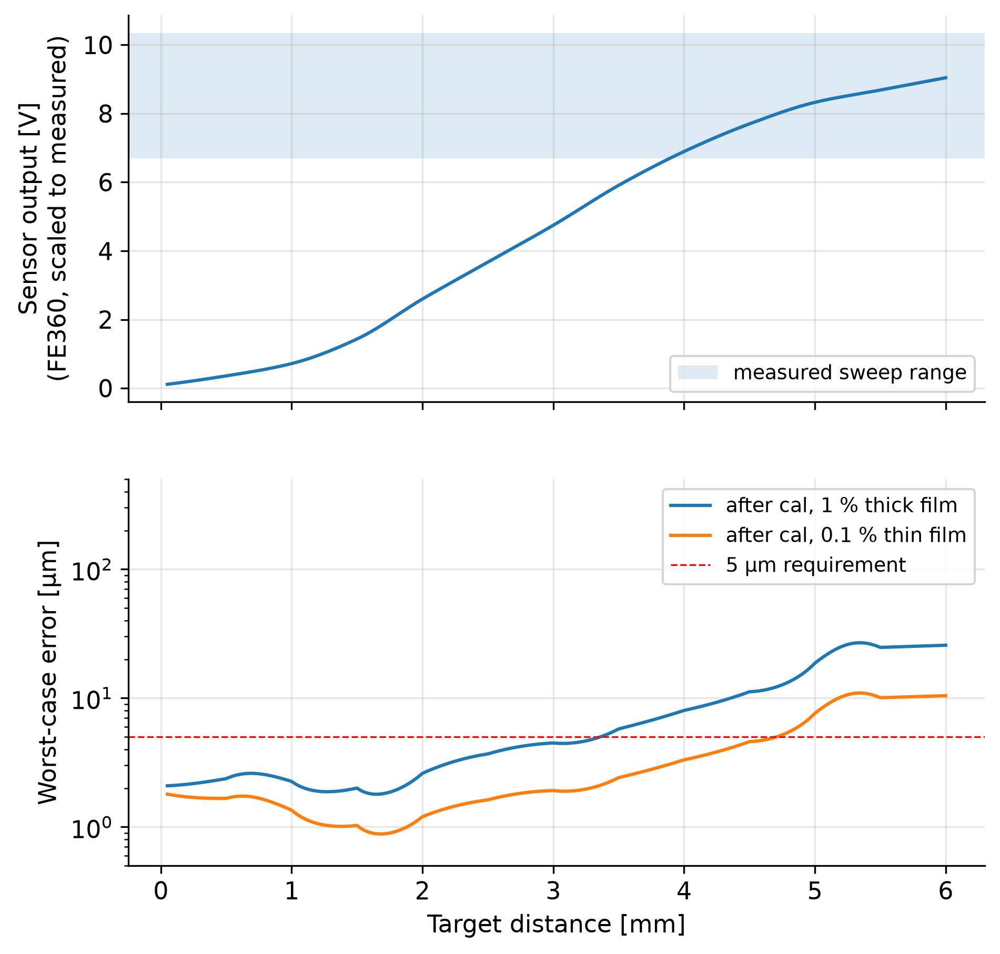

# 01: Prox input filter

**Domain:** electrical
**Tool(s):** ngspice 47, Python 3.13 (numpy / matplotlib / spicelib)
**Owner:** [@Mthanson1](https://github.com/Mthanson1)
**Status:** in progress

## Goal
Check the inductive-proximity sensor channel on the ADAM Calibration Board V2 (schematic sheets
4 and 7). The chain is 7.5k/1.8k divider → 1 kΩ Rs → Ccm/Cdiff → ADS1220. This study checks:

1. **Anti-aliasing (sim 1):** attenuation at the ADS1220 modulator frequency (256 kHz) is
   **≥ 50 dB** across component tolerances.
2. **CM-to-DM conversion (sim 1):** a 10 mV common-mode disturbance between the sensor return
   and ADC ground converts to less differential signal than the ADC noise (3.89 µVrms).
   That puts the limit at **≤ −68.2 dB**. It is checked at 60 Hz, where the ADC's 20 SPS
   50/60 Hz notch gets credit, and at 400 kHz, the buck frequency, where the analog filter
   gets no help.
3. **Settling (sim 2):** time to settle after a 0 → 10 V sensor step (informational).
4. **DC error budget (analysis 11):** error in µm of target distance along the sensor's
   output curve, before and after a two-point calibration. The requirement is
   **≤ 5 µm after calibration**. Also checks that the sensor's measured 10.35 V saturation
   fits in the ADC range.

## Setup
- Model files:
  - [`model/prox_filter.inc`](model/prox_filter.inc): one channel (CH0) as a subcircuit. It
    uses R13, R14, R25, R26, C28, C29 and C32 from
    [`shared/board/adam_cal_v2.csv`](../../shared/board/adam_cal_v2.csv).
  - [`model/ac_mc.cir`](model/ac_mc.cir): two copies of the channel, one driven
    differentially and one by a ground offset.
  - [`model/step.cir`](model/step.cir): 0 → 10 V step.
- Monte Carlo: 500 runs, each part uniform within its tolerance. That is ±1 % for the
  divider, ±0.1 % for Rs (precision), and ±2 % for Ccm and Cdiff (precision caps).
- ADC settings for the noise and error terms: normal mode, 20 SPS, gain 1, **PGA bypassed**.
  The bypass is required because AINN sits at AVSS (V_SENSE− is GND). Datasheet values with
  table and page references are in [`inputs/ads1220.csv`](inputs/ads1220.csv).
- Sensor curve: [`inputs/prox_sensor_curve.csv`](inputs/prox_sensor_curve.csv) is the Steel
  FE360 curve, digitized by eye (±0.1 V) from the DW-AS-509-M12-309 typical curves. FE360 is
  the standard rating target. The curve is scaled by 10.35/5.78: the plot saturates at 5.78 V,
  and the real sensor measured 10.35 V.
- Criteria and assumptions: [`inputs/criteria.csv`](inputs/criteria.csv).

## Assumptions
- The sensor output is an ideal voltage source. The sensor return equals board GND at the connector.
- The ADS1220 inputs are modeled as 5 pF each. The input current (≤ 15 nA, read from the
  axis limits of datasheet Fig 6-21 to 6-24) and the BAV199 leakage (5 nA) only enter the
  error budget. The clamp diodes' ~2 pF is negligible next to 10 nF.
- The noise tables were measured at AVDD = 3.3 V. This board runs the prox ADC at 5 V.
- **The real sensor's curve has the same shape as the datasheet's FE360 curve, scaled to its
  measured 10.35 V saturation.** The sweep data (device-monitor-261115-185349) shows the scale
  but not the distance axis, because steps/mm is not in hand. The closest point in the sweep,
  6.7 V, maps to about 3.9 mm on the scaled curve. A different target material changes the
  slope a lot; copper and aluminium saturate by 2.2 mm.
- Divider resistors are either the standard 1 % thick film at 100 ppm/K, or the 0.1 %
  precision option at 25 ppm/K (typical thin film, assumed). Neither assumes tracking. The lab
  temperature changes by ±10 K between calibration and use.

## How to reproduce
From the repo root with the venv active and ngspice installed (see the top-level README):

```powershell
python electrical/01-prox-input-filter/scripts/run_sims.py      # sims 1 + 2, ~1 min
python electrical/01-prox-input-filter/scripts/error_budget.py  # analysis 11
```

Each script prints a pass/fail table and writes it to `results/summary_*.csv` (not committed).
Each exits non-zero if any criterion fails.

## Results


| Criterion | Result | Limit | |
|---|---|---|---|
| DM −3 dB corner (nominal / MC range) | 435 Hz / 426–445 Hz | n/a | info |
| Attenuation at 256 kHz, MC worst | 58.0 dB | ≥ 50 dB | **PASS** |
| CM-to-DM at 400 kHz, nominal / MC worst | −59.0 / −58.5 dB | ≤ −68.2 dB | **FAIL** |
| CM-to-DM at 60 Hz, analog only / with 20 SPS notch | −44.9 / −134.9 dB | ≤ −68.2 dB | **PASS** |
| Settling to 0.1 % / 16 bit | 2.53 / 4.06 ms | n/a | info |

The corner is 435 Hz, not the 461 Hz hand calc. The hand calc ignores the two Ccm, which add
Ccm/2 = 5 nF in parallel with Cdiff. Settling is slower than the sensor's 1 ms response.
That is fine for static calibration, but it would limit a dynamic measurement.

**The CM conversion comes from the circuit's asymmetry, not from part tolerances.** The divider
puts R13‖R14 = 1.45 kΩ in series with the + leg only. Moving each part to its tolerance limit
shifts the 400 kHz conversion by less than 1 dB, so tighter Ccm matching would not help.
Balancing the − leg would: **R26 = 2.43 kΩ** (Rs + R13‖R14) gives −103 dB at 400 kHz and
−82 dB at 60 Hz. The costs are a 310 Hz corner and 3.5 ms settling to 0.1 %. The dashed curves
in the figure show this variant.

The FAIL is against the analog filter alone. In practice the ADS1220 digital filter adds
rejection at 400 kHz. 400 kHz is 112 kHz from the nearest multiple of f_mod, far outside the
13 Hz bandwidth at 20 SPS, so it does not alias near DC. The datasheet does not give a figure
that rejection could be credited from, though. Conversion also peaks near −28 dB around
1–3 kHz. The 20 SPS filter rejects that band, but it would show up at higher data rates.




| Error budget, worst-case sum | 1 % thick film | 0.1 % thin film | Limit |
|---|---|---|---|
| Uncalibrated, steepest point (1.8 mm, 2.5 V/mm) | 16.1 µm | 3.8 µm | info |
| After calibration, steepest point | 1.95 µm **PASS** | 0.93 µm **PASS** | ≤ 5 µm |
| After calibration, measured dip (6.7 V, ~3.9 mm, 1.9 V/mm) | **7.4 µm FAIL** | 3.1 µm **PASS** | ≤ 5 µm |
| Distance range meeting 5 µm after calibration | 0–3.4 mm | 0–4.7 mm | info |
| Max V_IN inside ADC range (worst-case divider and reference) | 10.40 V **PASS** | 10.55 V **PASS** | ≥ 10.35 V |


The sensor curve makes the budget depend on distance. Error is smallest where the curve is
steepest, and grows quickly as it flattens toward saturation. After calibration, the divider's
untracked resistor drift is the largest term. The ADC's own terms stay under about 1 µm at the
steepest point, led by reference drift.

**Headroom is tight with 1 % resistors.** The measured 10.35 V saturation is only 0.5 % below
the worst-case ADC clipping point of 10.40 V. A unit that saturates a little higher, or runs
warm, could clip. With 0.1 % resistors the clipping point is 10.55 V.

## Conclusions
- Anti-aliasing passes with 8 dB of margin across tolerances.
- CM rejection at the buck frequency fails the analog-only criterion by about 10 dB, because the
  source impedance is unbalanced. **Recommended fix:** set R26 and R28 to 2.43 kΩ, and confirm
  on hardware by measuring with the buck running.
- **5 µm is met at 0–3.4 mm with 1 % divider resistors, or 0–4.7 mm with 0.1 % thin film.**
  The recorded sweep's closest point (~3.9 mm) falls outside the 1 % range. Use 0.1 %,
  ≤ 25 ppm/K resistors for R13–R16. That also fixes the 0.5 % ADC headroom at the sensor's
  10.35 V saturation.
- Run measurements as close to the target as the setup allows (the steepest part of the
  curve, near 1.5–2 mm), and keep away from saturation.
- Next steps:
  - Get steps/mm for the sweep rig, so the measured flank (about 27.6 mV/step) can replace
    the scaled datasheet curve.
  - Confirm the target material.
  - The repeatability plot shows the fitted minimum shifting about 5 steps over sweeps 3–5,
    and the ADS1220 and the STM32 ADC agree on the shift. So the shift comes from the sensor
    or the mechanics, not the ADC channel.
