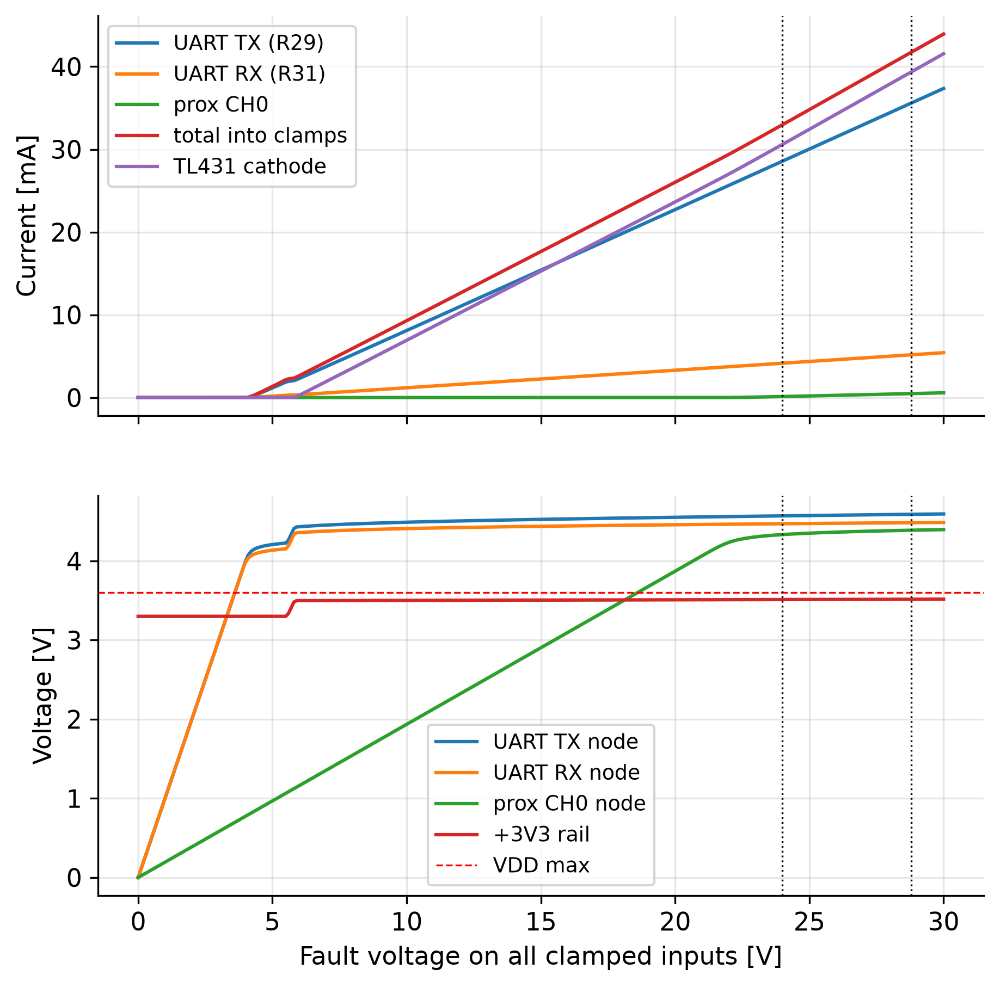
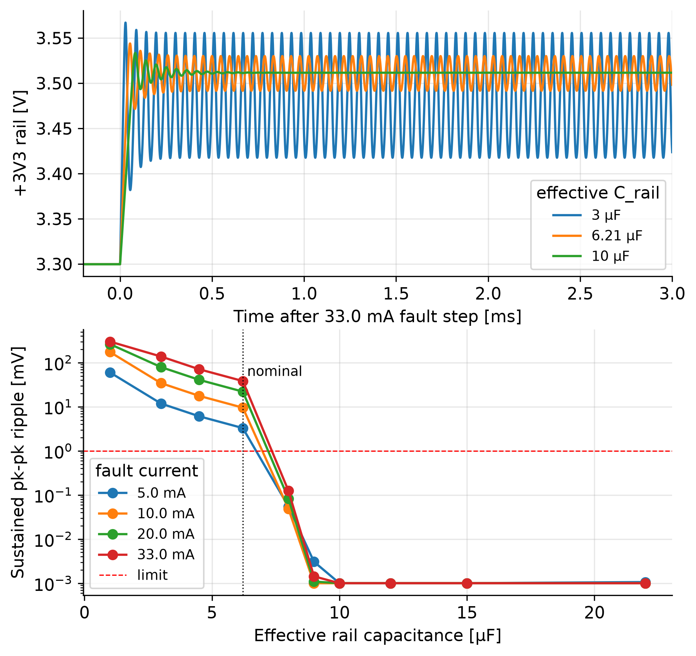
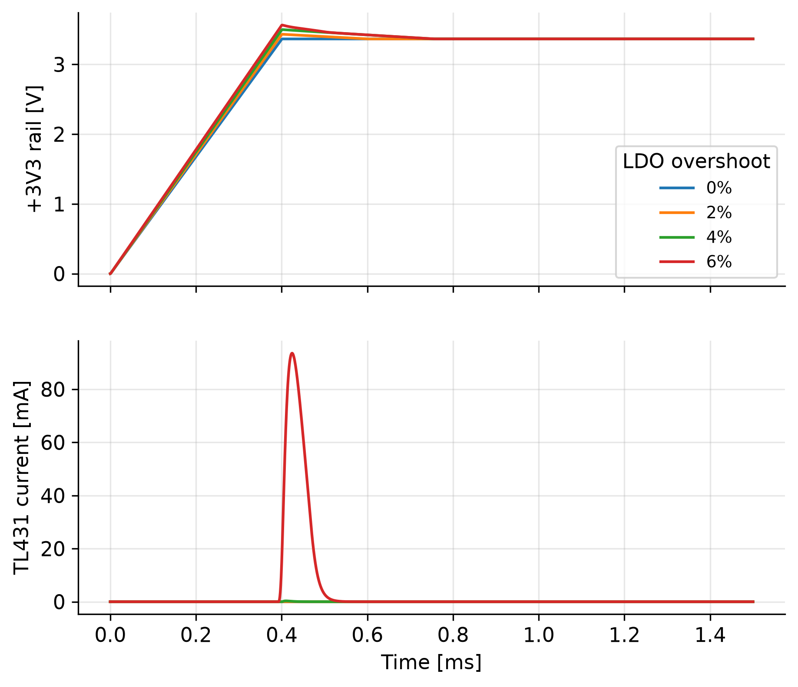
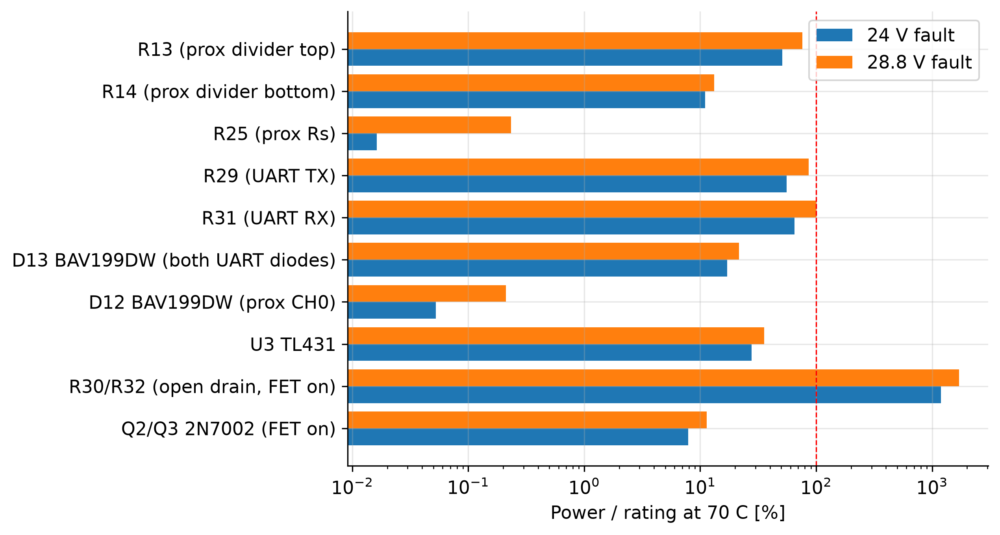

# 02: TL431 fault clamp

**Domain:** electrical
**Tool(s):** ngspice 47 (TI TL431 PSpice model SLVM071B), Python 3.13
**Owner:** [@Mthanson1](https://github.com/Mthanson1)
**Status:** in progress

## Goal
The clamp protects the MCU and ADC inputs when +24 V is shorted onto the connector pins. The
BAV199 pairs steer the fault current into +3V3. The TLV773 LDO cannot sink current, so the
TL431 shunt (R7/R8 → 3.498 V) absorbs whatever the 3V3 loads don't. Schematic sheet 2 has the
hand-calc budget. This study checks:

1. **DC fault sweep (sim 4):** with all clamped inputs driven 0–30 V:
   - +3V3 rail ≤ 3.6 V (STM32 VDD max)
   - TL431 current ≤ 100 mA
   - prox clamp node ≤ 5.3 V (ADS1220 abs max, AVDD + 0.3 V)
2. **Clamp stability (sim 5):** after a fault-current step, no sustained oscillation, meaning
   **≤ 1 mV pk-pk** on the rail 2–3 ms after the step. Swept over 1–22 µF effective rail
   capacitance and 5–33 mA.
3. **Power-up (sim 8):** the TL431 must not conduct when the LDO is at its maximum output.
   The criterion is clamp threshold (min) − LDO output (max) **≥ 0** in the lab (25 °C ± 10 K).
   Start-up overshoot is swept as well, because the TLV773 datasheet doesn't specify it.
4. **Fault thermal check (analysis 12):** power in every part on a clamped or open-drain path
   at 24 V and 28.8 V, against its rating at 70 °C ambient.

## Setup
- Model files:
  - [`model/rail.inc`](model/rail.inc): the +3V3 rail. The LDO is behavioral (10 S toward its
    set-point, source-only, 350 mA limit). The load is a 2 mA minimum, and the rail has
    TL431 + R7/R8 and C_rail + ESR.
  - [`model/fault_paths.inc`](model/fault_paths.inc): prox CH0/CH1 (divider + Rs), UART TX
    (R29) and UART RX (R31), each into a BAV199 pair.
  - [`dc_fault_sweep.cir`](model/dc_fault_sweep.cir), [`stability_tran.cir`](model/stability_tran.cir),
    [`powerup.cir`](model/powerup.cir).
- Vendor models: [`shared/spice_models/`](../../shared/spice_models/README.md).
  - TL431: TI's unencrypted PSpice model.
  - BAV199: **fitted to the datasheet's max Vf**, not a vendor model. Nexperia's download
    blocks automated access.
- Nominal rail capacitance: C6 + C7 + C18 + C20–C24 = **6.21 µF** (the schematic's
  "C_OUT on +3V3" note). Device data and assumptions:
  [`inputs/devices.csv`](inputs/devices.csv), [`inputs/criteria.csv`](inputs/criteria.csv).

## Assumptions
- The 3V3 load is 2 mA, with the MCU in reset. More load would take fault current away from
  the TL431.
- The MCU's USART1_TX pin is left out of the fault sweep. When it drives high it only adds
  another path into the rail, and leaving it out gives the highest node voltage. The TX-low
  case is reported separately. PA10 (RX) is assumed 5 V-tolerant, with no diode to VDD.
- The ADS1220 inputs (AVDD = 5 V) stay below their ESD diodes (4.4 V < 5.3 V), so they carry
  no fault current.
- The TL431 reference drift over the lab range is a linear share of the datasheet's
  50 mV / 125 K deviation band.
- Resistors with no package in the parts table are treated as 0603 at 0.1 W. That covers
  R13–R16 and R25–R28.
- 2N7002 R_DS(on) is the 7 Ω max at V_GS = 5 V. At 3.3 V gate drive it is higher, which only
  lowers the fault current.

## How to reproduce
```powershell
python electrical/02-tl431-fault-clamp/scripts/run_sims.py       # sims 4, 5, 8 (~20 s)
python electrical/02-tl431-fault-clamp/scripts/thermal_check.py  # analysis 12 (run_sims first)
```

Both print a pass/fail table, write `results/summary_*.csv`, and exit non-zero on a FAIL.

## Results


| At 24 V fault (28.8 V) | Result | Limit | |
|---|---|---|---|
| Total clamp current | 33.0 mA (41.8 mA) | n/a | info (hand calc 34.1 mA) |
| TL431 cathode current | 30.6 mA (39.4 mA) | ≤ 100 mA | **PASS** |
| +3V3 rail | 3.512 V (3.515 V) | ≤ 3.6 V | **PASS** |
| Prox clamp node | 4.33 V (4.39 V) | ≤ 5.3 V | **PASS** |
| UART TX / RX clamp node | 4.57 / 4.47 V | n/a | info (hand calc ≤ 4.58 V) |

UART TX carries almost all the fault current (28.6 mA through R29). The prox legs carry
almost none: the divider holds their node near the clamp voltage (0.1 mA, versus 0.26 mA in
the hand calc).



| Stability | Result | Limit | |
|---|---|---|---|
| Sustained ripple at 6.21 µF, 33 mA | **38 mV pk-pk at ~21 kHz** | ≤ 1 mV | **FAIL** |
| Smallest effective C stable at every current | 8 µF | n/a | info |

**With the TI model, the clamp oscillates at the board's nominal 6.21 µF.** This matches the
unstable region on the TL431 datasheet stability chart (pasted on sheet 2). It is not a
numerical artifact: a 10× finer timestep gives the same 39.6 mV. The rail still stays below
3.6 V while it oscillates, so the MCU is not over-volted. But a clamp that is oscillating
during a fault is not doing its job cleanly. Two things stabilize it:
- **≥ 8 µF effective** capacitance. Ceramics lose capacitance under DC bias, so aim for
  ≥ 10 µF effective. For example, change C6 from 1 µF to 10 µF (15.2 µF nominal total). Check
  the chosen part's DC-bias curve, and stay under the TLV773's 40 µF maximum.
- Or **~0.2 Ω of ESR** in the bulk capacitor. A sweep at 6.21 µF and 0.2 Ω showed no ringing.



| Power-up | Result | Limit | |
|---|---|---|---|
| Clamp threshold min − LDO max, lab | 71.7 mV | ≥ 0 | **PASS** |
| Same, −40 to 85 °C | −8.9 mV | n/a | info |
| TL431 peak current with 0 / 2 / 4 / 6 % start-up overshoot | 0 / 0 / 0.3 / 94 mA | n/a | info |

With nominal TL431 parts, the TL431 stays off unless the LDO overshoots by about 4 % or more
on top of its +2 % tolerance (the sim uses the nominal 3.498 V threshold). Over the full temperature range the worst-case threshold and the LDO's maximum
output overlap by about 9 mV. In that corner the TL431 would fight the LDO, and the current
would be set by the LDO's 350 mA+ limit, well above the TL431's power rating. That needs
temperature extremes and worst-case parts at the same time, so it is not a concern on a lab
bench. Raising R7 to 4.12 kΩ would remove the overlap.



| Fault power (24 V / 28.8 V) | Power | Rating | |
|---|---|---|---|
| R29 UART TX, 2512 | 555 / 862 mW | 1 W | PASS (86 % at 28.8 V) |
| R31 UART RX, 0805 | 81 / 126 mW | 125 mW | PASS / **FAIL** (101 %) |
| R13 prox divider top | 51 / 76 mW | 100 mW (assumed 0603) | PASS |
| TL431 | 108 / 138 mW | 388 mW (θJA 206 K/W, 70 °C) | PASS |
| BAV199DW, both UART diodes | 34 / 43 mW | 200 mW | PASS |
| R30/R32 open drain, FET on | 1190 / 1713 mW | 100 mW (assumed 0603) | **FAIL** |
| 2N7002 | 18 / 26 mW | 225 mW | PASS |

The R30/R32 FAIL is by design: the schematic note says the resistor "fails before NMOS".
Thick film usually fails open under that overload, but that is not guaranteed. A 1206 or
larger part, or a PTC, would make the open-drain outputs survive a fault instead.

If the MCU happens to be driving TX low when the fault hits, about **33 mA** flows into the
STM32 pin through R29 (24 V / 720 Ω). Check that against the STM32G474 I/O current limit.

## Conclusions
- The DC clamp works as designed: the rail holds at 3.51 V up to 30 V, with 3× margin on
  TL431 current.
- **The clamp is unstable at the nominal 6.21 µF.** Raise the effective rail capacitance to
  ≥ 10 µF, for example C6 → 10 µF. This is the most important change from this study.
- R31 is at its 0805 rating at 28.8 V. Use 1206 for margin. R29 has 14 % margin at 28.8 V.
- The LDO/TL431 margin is fine in the lab. Raise R7 to 4.12 kΩ if the board ever has to
  work across the full temperature range.
- Next steps: replace the fitted BAV199 with the Nexperia model, and check the STM32 pin limits.
