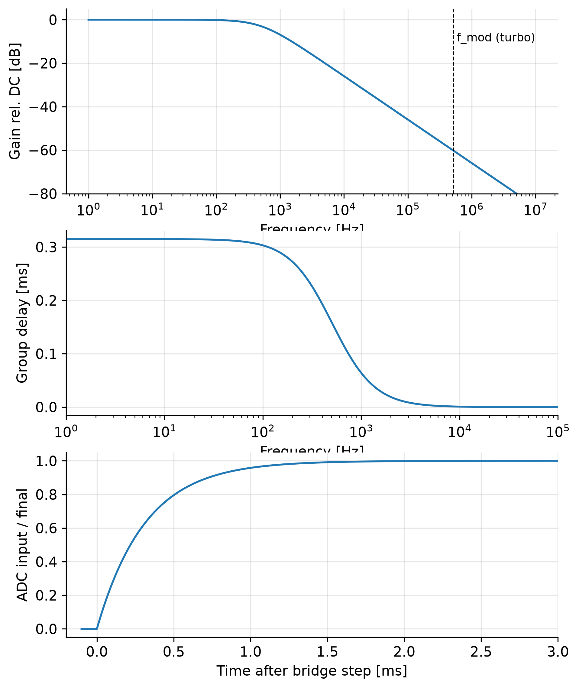
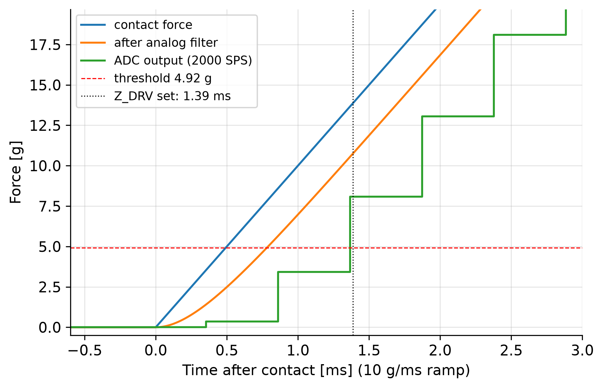
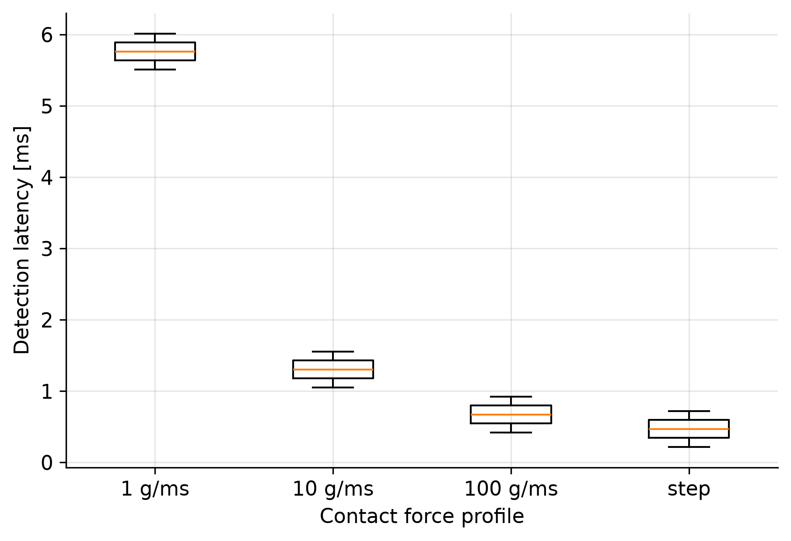

# 03: Load cell contact detection

**Domain:** electrical
**Tool(s):** ngspice 47, Python 3.13
**Owner:** [@Mthanson1](https://github.com/Mthanson1)
**Status:** in progress

## Goal
Can the load cell channel (schematic sheet 3) detect probe contact quickly and reliably enough
to drive Z_CONTACT? This study checks:

1. **Analog filter (sim 3):** corner, group delay, step response, and attenuation at the
   turbo-mode modulator frequency (512 kHz, **≥ 50 dB**).
2. **Contact detection (analysis 10):**
   - force noise and resolution at turbo 2000 SPS, gain 128
   - a 6σ trigger threshold and its false-trigger rate
   - detection latency from first contact to Z_DRV, through the analog filter, the ADC
     conversion and firmware
   - overtravel at the probing speed, **≤ 10 µm (provisional)**

## Setup
- Model files:
  - [`model/loadcell_filter.inc`](model/loadcell_filter.inc): a bridge with 1 kΩ output
    resistance (the schematic's R_BRDG estimate), then R10/R11, C10/C11 and C12 from the
    parts table, then the ADC pins.
  - [`model/ac.cir`](model/ac.cir), [`model/step.cir`](model/step.cir).
- ADS1220 data, with table and page references: [`inputs/ads1220.csv`](inputs/ads1220.csv).
  - Turbo 2000 SPS, gain 128: 0.82 µVrms, 5.81 µVpp.
  - Conversion period 2072 tCLK = 505.9 µs.
- Latency model ([`scripts/contact_latency.py`](scripts/contact_latency.py)):
  1. The contact force is convolved with the simulated filter step response.
  2. Each ADC result is the average of its own 505.9 µs window. The datasheet says the filter
     settles in a single cycle, but TI does not publish the exact FIR weighting.
  3. The result is compared with the threshold when DRDY fires, and firmware adds 20 µs.
  4. The contact instant is swept across one conversion period (200 phases).

## Assumptions
- **The load cell is the planned FRC4115: 5 kg capacity, 1 mV/V rated output.** Excited at
  5 V, that is 5 mV full scale, inside the ±16 mV range at gain 128. Force noise, threshold
  and resolution all scale as capacity / (mV/V).
- The bridge output resistance is 1 kΩ.
- The noise is white and Gaussian, with samples independent. The datasheet table uses the
  internal 2.048 V reference. TI states that input-referred noise "only changes marginally"
  with an external reference, and this board uses a ratiometric 5 V reference.
- Contact force ramps at 1, 10 or 100 g/ms (stiffness × speed), or steps to 50 g.
- The probing speed is 5 mm/s. The 10 µm overtravel limit is provisional; replace it with the
  ADAM probing requirement.
- Firmware time is 20 µs: DRDY interrupt, a 24-bit SPI read, a compare, and a GPIO write.
  Delay through the Z_CONTACT open drain and the Duet input is covered in study 04.

## How to reproduce
```powershell
python electrical/03-loadcell-contact-detect/scripts/run_sims.py         # sim 3
python electrical/03-loadcell-contact-detect/scripts/contact_latency.py  # analysis 10 (~10 s)
```

## Results


| Analog filter | Result | Limit | |
|---|---|---|---|
| DM −3 dB corner | 505 Hz | n/a | info |
| Group delay at DC | 0.315 ms | n/a | info |
| Attenuation at 512 kHz | 60.1 dB | ≥ 50 dB | **PASS** |
| Step: 50 % / 90 % | 0.22 / 0.73 ms | n/a | info |

The corner is 505 Hz, not the 531 Hz hand calc, because the hand calc leaves out Ccm/2.



| Detection (FRC4115, 5 kg, 1 mV/V) | Result | |
|---|---|---|
| Force noise (rms) / noise-free resolution (pk-pk) | 0.82 g / 5.8 g | info |
| 6σ trigger threshold | 4.9 g | info |
| Mean time between false triggers at 6σ | 142 h | info |



| Contact profile | Latency mean / max | Overtravel at 5 mm/s, max | ≤ 10 µm |
|---|---|---|---|
| Step to 50 g | 0.47 / 0.72 ms | 3.6 µm | **PASS** |
| 100 g/ms ramp | 0.67 / 0.92 ms | 4.6 µm | **PASS** |
| 10 g/ms ramp | 1.30 / 1.56 ms | 7.8 µm | **PASS** |
| 1 g/ms ramp | 5.76 / 6.01 ms | **30.1 µm** | **FAIL** |

Latency comes from three parts:
- the time for the force itself to reach the threshold (4.9 ms at 1 g/ms)
- the analog filter delay (~0.3 ms)
- waiting for the conversion window to finish (0–0.5 ms, depending on phase)

The ADC conversion, not the analog filter, sets the floor for a hard contact. Stiff contacts
are detected in under 0.6 ms. Soft contacts are limited by the threshold, not the electronics.

## Conclusions
- The analog filter passes anti-aliasing at turbo speed with 10 dB of margin. It adds about
  0.3 ms of delay.
- With the FRC4115 (5 kg, 1 mV/V), a 6σ threshold sits at 4.9 g. That gives one false
  trigger per ~140 h at 2000 SPS. Stiff contacts (≥ 10 g/ms) stay within 10 µm of
  overtravel at 5 mm/s. **Soft contacts (1 g/ms) take about 6 ms and overtravel about
  30 µm**, because the force itself needs 4.9 ms to reach the threshold.
- A 5 kg cell spends most of its range unused in probing. Two ways to bring the threshold
  down, starting with the firmware option:
  - **Firmware:** require two consecutive samples over 4.5σ (3.7 g). Two independent samples
    over 4.5σ are about as rare as one over 6σ, so false triggers drop to almost nothing, but
    detection costs up to one extra conversion (0.5 ms).
  - **Hardware:** a lower-capacity or higher-output cell (e.g. 1 kg, 2 mV/V) lowers the
    threshold 10× directly.
- Next steps: set the ADAM overtravel requirement (10 µm is provisional) and measure the
  real contact stiffness × probing speed (the g/ms ramp). Every number above scales
  linearly with capacity / (mV/V).
