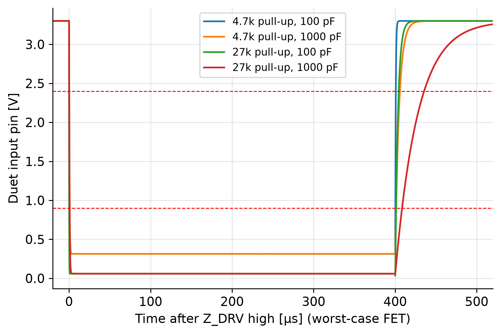
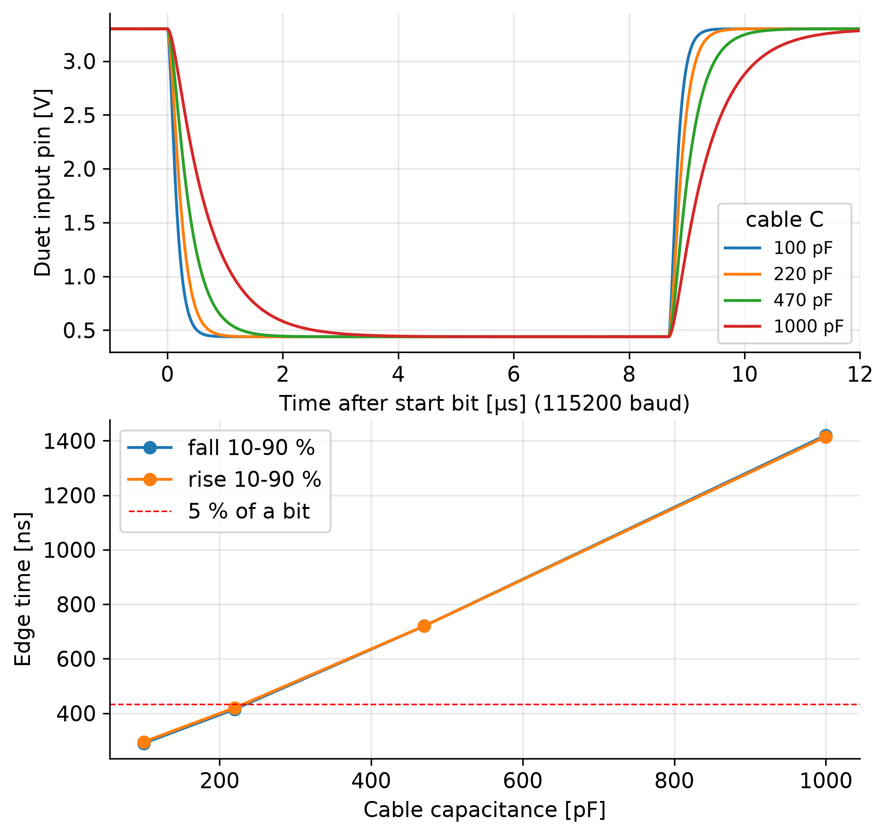

# 04: Duet I/O interface

**Domain:** electrical
**Tool(s):** ngspice 47, Python 3.13
**Owner:** [@Mthanson1](https://github.com/Mthanson1)
**Status:** in progress

## Goal
Check the signals between the calibration board and the Duet (schematic sheets 6 and 8).

1. **Z_CONTACT / OUT0 open drain (sim 6):** MCU → 2N7002 → R30/R32 (470 Ω) → cable → Duet
   input. The pull-up is 4.7k for the opto input or 27k otherwise, then 10k series into the pin.
   - V_low **≤ V_IL (0.9 V)** with the worst-case FET
   - release to V_IH **≤ 100 µs** (10 % of a 1 ms budget)
   - fault power with 24 V on the connector and the FET on
2. **UART TX (sim 7):** MCU pin (~40 Ω) → BAV199 clamp node → R29 (680 Ω) → cable → Duet
   4.7k / 10k.
   - V_low **≤ V_IL**
   - 10–90 % edges **≤ 5 % of a bit** at 115200 baud (434 ns)
   - the largest cable capacitance that meets the edge limit

## Setup
- Model files:
  - [`model/duet_input.inc`](model/duet_input.inc): the Duet input network as drawn on
    sheet 6. The pull-up is on the connector node, consistent with the sheet's
    V_LOW = 3.3·R_SERIES/(4.7k + R_SERIES) note.
  - [`model/open_drain.cir`](model/open_drain.cir) and
    [`model/open_drain_fault.cir`](model/open_drain_fault.cir): each contains a typical and a
    worst-case FET.
  - [`model/uart_tx.cir`](model/uart_tx.cir).
- 2N7002: [`shared/spice_models/nmos_2n7002.lib`](../../shared/spice_models/nmos_2n7002.lib).
  This is a **Level 1 fit to the onsemi datasheet**, not a vendor model. The typical variant
  uses V_th 2.1 V and 1.7 Ω at V_GS = 5 V. The worst-case variant uses V_th 2.5 V and 7.5 Ω at
  V_GS = 5 V. At the MCU's 3.3 V gate drive that works out to about 4.5 Ω and 23 Ω.
- BAV199: datasheet-fitted model (see study 02).
- Criteria: [`inputs/criteria.csv`](inputs/criteria.csv).

## Assumptions
- Cable capacitance is 100 pF–1 nF, roughly 1–10 m. The Duet input pin is 10 pF.
- The MCU pin is an ideal 3.3 V source behind 40 Ω.
- The Level 1 FET fit is good enough for R_DS(on) and saturation current. Its capacitances
  are fixed at the datasheet's 25 V values.

## How to reproduce
```powershell
python electrical/04-duet-io-interface/scripts/run_sims.py   # ~6 s
```

## Results


| Open drain, worst-case FET | 4.7k, 100 pF | 4.7k, 1 nF | 27k, 100 pF | 27k, 1 nF | Limit |
|---|---|---|---|---|---|
| V_low at Duet pin | 0.31 V | 0.31 V | 0.06 V | 0.06 V | ≤ 0.9 V **PASS** |
| Fall to V_IL | 0.26 µs | 0.88 µs | 0.22 µs | 0.80 µs | info |
| Rise to V_IH | 0.83 µs | 5.9 µs | 4.4 µs | 35.5 µs | ≤ 100 µs **PASS** |

Asserting Z_CONTACT adds under 1 µs to the contact latency from study 03.

| Open-drain fault, 24 V on connector, FET on | Typical FET | Worst-case FET |
|---|---|---|
| Current | 50.6 mA | 19.6 mA (FET saturates) |
| R30 power (0603, 100 mW) | 1202 mW **FAIL** | 180 mW **FAIL** |
| 2N7002 power (225 mW) | 12 mW PASS | **290 mW FAIL** |

The schematic expects R30/R32 to "fail before the NMOS", and with a typical FET it does.
**With a worst-case FET, the design intent doesn't hold.** At 3.3 V gate drive, a 2.5 V
threshold part saturates near 20 mA. It then drops most of the 24 V itself (290 mW), while
R30 sees only 180 mW. Both parts end up overloaded, and nothing guarantees which fails first.
Options:
- Use a logic-level FET with lower V_th, so it stays in its linear region.
- Make R30/R32 a part that survives, for example 1206 / 0.25 W with a larger value.
- Add a PTC or a clamp on the connector side.



| UART TX | Result | Limit | |
|---|---|---|---|
| V_low at Duet pin | 0.44 V | ≤ 0.9 V | **PASS** |
| Slowest edge at 100 pF | 295 ns | ≤ 434 ns | **PASS** |
| Slowest edge at 220 / 470 / 1000 pF | 420 / 720 / 1420 ns | n/a | info |
| Largest cable C for 5 % edges | 232 pF | n/a | info |

The edge time is set by (40 Ω + 680 Ω) ‖ 4.7k ≈ 625 Ω driving the cable. At 115200 baud the
5 % criterion allows about 230 pF, roughly 2 m of typical cable. A UART samples mid-bit, so
even the 1 nF case (16 % of a bit) would most likely still work. It just has less timing
margin.

## Conclusions
- The open drain works with either Duet input type and any cable up to 1 nF.
- **Fault survival depends on the FET's threshold.** The "R30 fails first" assumption from
  sheet 6 only holds with typical parts. This also revises the R30/R32 row of study 02's
  thermal table, which assumed a 7 Ω FET.
- UART TX meets 5 % edges up to about 230 pF of cable. Keep the Duet cable under about 2 m, or
  lower R29 if longer cables are needed. Lowering R29 raises the fault current, so recheck
  study 02 if you do.
