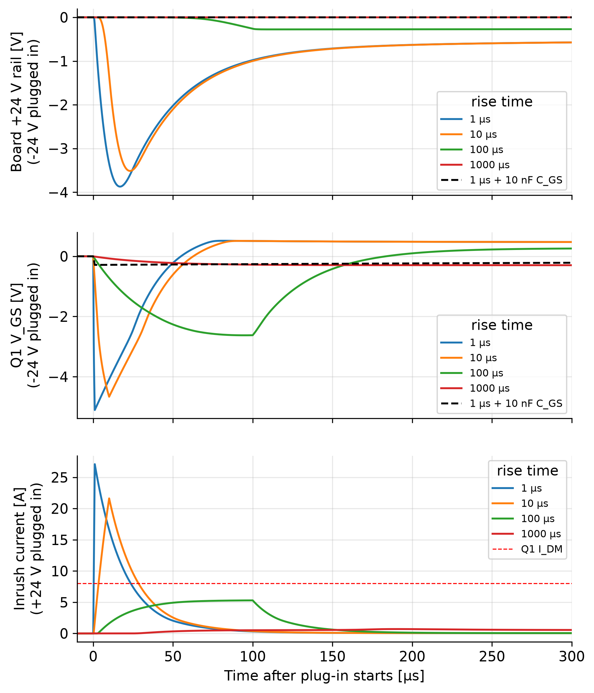

# 05: Reverse polarity and hot-plug

**Domain:** electrical
**Tool(s):** ngspice 47 (Vishay Si2309CDS model), Python 3.13
**Owner:** [@Mthanson1](https://github.com/Mthanson1)
**Status:** in progress

## Goal
Check the 24 V input stage (schematic sheet 2): J1 → F1 → SMAJ33CA → Q1 (Si2309CDS high-side
PMOS, R3 gate pull-down, ZD1 15 V gate clamp) → board +24 V.

1. **Reversed supply (sim 9):** −24 V plugged in. The supply's rise time is swept from 1 µs
   to 1 ms, because a fast edge couples through Q1's C_rss onto its gate.
   - board rail stays **≥ −0.3 V**
   - Q1 |V_GS| **≤ 20 V**
   - steady current limited to leakage
2. **Forward hot-plug:** +24 V plugged in, also swept over rise time.
   - inrush into C1 against Q1's pulsed rating, **I_DM 8 A**
   - Q1 drop and the gate clamp in steady state

## Setup
- Model files:
  - [`model/rev_pol.cir`](model/rev_pol.cir): the input stage, with a 480 Ω load and C1 from
    the parts table. It also includes the two sensor-supply branches (F2/F3 at 2.8 Ω, then
    SMAJ28A to GND), because those TVS diodes forward-conduct if the board rail goes negative.
  - An optional gate-source capacitor, `CGSEXT`, is in the netlist to test the proposed fix.
- Q1: Vishay's Si2309CDS model
  ([`shared/spice_models/si2309cds_vishay.lib`](../../shared/spice_models/si2309cds_vishay.lib)).
  It models C_rss as nonlinear, which matters here.
- TVS and zener: fitted stand-ins in [`model/input_devices.lib`](model/input_devices.lib).
  - SMAJ33CA: two series zeners at 36.7 V.
  - SMAJ28A: a 31.1 V zener.
  - BZT52C15: a 15 V zener.
- F1 is a fixed 0.8 Ω (its initial resistance). PTC tripping is not modeled; it acts over
  seconds, far slower than these events.
- Criteria: [`inputs/criteria.csv`](inputs/criteria.csv).

## Assumptions
- The board draws 50 mA from +24 V.
- The supply is ideal, with a linear ramp. **There is no cable inductance and no supply output
  impedance.** Both slow the edge, so fast-edge results are the worst case for each rise time.
- −0.3 V is used as a generic IC supply-pin minimum. Verify it against the LMR51606 datasheet.
- I_DSS comes from the datasheet (1 µA max at 25 °C).

## How to reproduce
```powershell
python electrical/05-reverse-polarity/scripts/run_sims.py
```

## Results


| Reversed supply (−24 V), as built | 1 µs rise | 10 µs | 100 µs | 1 ms | Limit |
|---|---|---|---|---|---|
| Board rail minimum | **−3.87 V** | **−3.51 V** | −0.28 V | ~0 | ≥ −0.3 V |
| | **FAIL** | **FAIL** | PASS (marginal) | PASS | |
| Q1 \|V_GS\| peak | 5.1 V | 4.7 V | 2.6 V | 0.3 V | ≤ 20 V PASS |
| Supply current peak | 12.2 A | 9.1 A | 0.19 A | ~0 | info |
| **With 10 nF gate-source capacitor:** board rail minimum | −0.2 mV | −0.2 mV | −0.2 mV | −0.1 mV | ≥ −0.3 V **PASS** |

**A fast reversed hot-plug turns Q1 on.** The drain steps to −24 V, and Q1's gate-drain
capacitance pulls the gate down with it. R3 (100k) can't hold the gate at 0 V on that time
scale. V_GS reaches −5 V, which is well past the 1–3 V threshold, so Q1 fully conducts in
reverse for about 30 µs:
- The board rail is dragged to −3.9 V.
- The supply delivers up to 12 A, limited only by F1 and R_DS(on).
- The sensor-supply TVS diodes forward-conduct but can't clamp the rail, because F2/F3 sit in
  series.
- C1 is drawn as a polarized 22 µF capacitor. A few volts of reverse bias is outside what an
  aluminium electrolytic tolerates.

**An earlier fitted model missed this.** It used the datasheet's constant C_rss of 20 pF at
V_DS = −30 V. Vishay's model has the real non-linear C_rss, which is several times larger
near V_DS = 0, exactly where a hot-plug edge starts.

**Fix:** add **10 nF from Q1's gate to its source**, in parallel with ZD1. This capacitor is
much larger than C_rss, so it divides the coupled edge down to −0.28 V, below the threshold.
The rail then stays at 0 V for every rise time. The cost is a slower forward turn-on
(R3 × 10 nF ≈ 1 ms). During that millisecond Q1's body diode carries the 50 mA load, which
is well within its 1.4 A rating. 47 nF also works (−0.06 V), with a 4.7 ms turn-on.

| Forward hot-plug (+24 V) | 1 µs rise | 10 µs | 100 µs | 1 ms | Limit |
|---|---|---|---|---|---|
| Inrush peak | 27.1 A | 21.6 A | 5.3 A | 0.70 A | ≤ 8 A |
| | **FAIL** | **FAIL** | PASS | PASS | |

| Forward steady state | Result | Limit | |
|---|---|---|---|
| Q1 drop at 50 mA | 16.4 mV | n/a | info |
| Q1 \|V_GS\| (ZD1 clamped) | 14.9 V | ≤ 20 V | **PASS** |

With an ideal fast-rising supply, only F1's 0.8 Ω limits the inrush into C1, and the peak
exceeds Q1's 8 A pulsed rating. The current flows through Q1's body diode before the channel
turns on, so the gate capacitor does not change it. In a real plug-in, cable inductance and
the supply's own output impedance stretch the edge. A ≥ 70 µs edge keeps the peak under 8 A.

## Conclusions
- **Reverse polarity is blocked in steady state** (leakage ≤ 1 µA). **A fast reversed hot-plug
  is not blocked:** Q1 turns on through its C_rss and drives the board rail to about −4 V.
  **Add 10 nF gate-source to Q1.** It removes the problem at every rise time, at the cost of a
  1 ms forward turn-on.
- Hot-plugging a stiff 24 V supply into the 22 µF C1 can exceed Q1's pulsed rating if the edge
  is faster than about 70 µs. Options:
  - Measure the real plug-in edge with the intended supply and cable.
  - Add inrush limiting, or a higher-rated FET.
  - Reduce C1, if the TVS clamping allows it.
- Next step: model the cable inductance once the harness is known. It slows both edges and
  should ease both findings.
