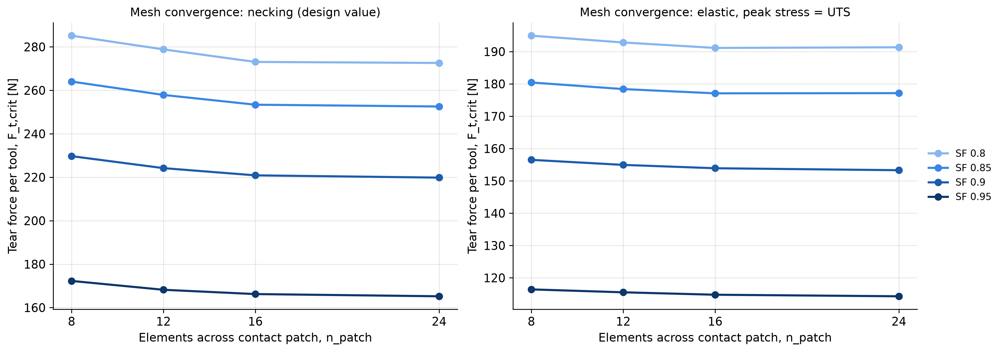
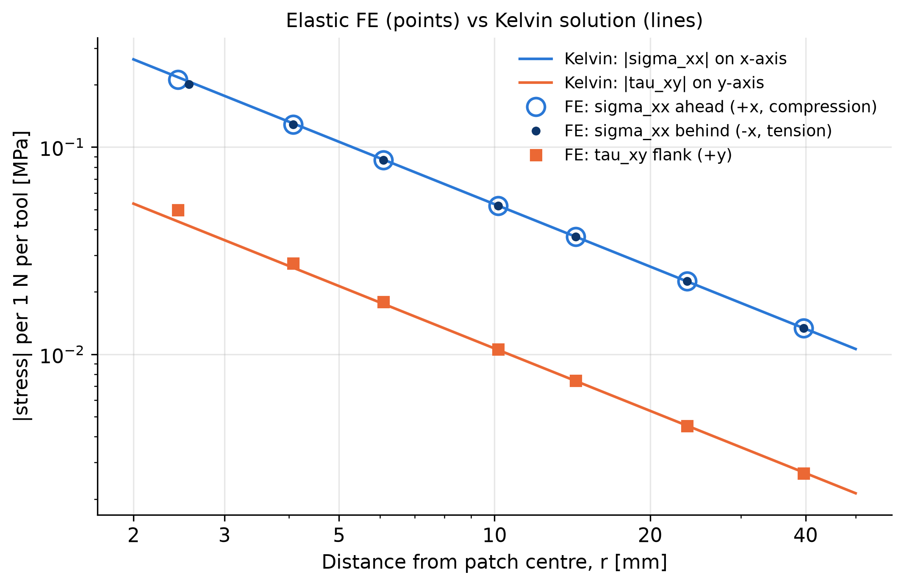

# 01: DSIF friction limit: model description

This document describes the model in [`scripts/dsif_friction_limit.py`](scripts/dsif_friction_limit.py):
the physics, the assumptions, and how the finite element model is built and solved.
Results and conclusions are in the [README](README.md).

Units throughout: mm, N, MPa.

---

## 1. Physics

### 1.1 The process
In double-sided incremental forming (DSIF), a sheet is clamped in a frame and shaped by two
small hemispherical tools, one on each face. The **forming tool** pushes into the sheet. The
**supporting tool** on the opposite face follows it and squeezes the sheet between the two tips.
Both tools move together along a toolpath, gradually forming the part one small contact at a time.

The gap between the tool tips is set smaller than the sheet thickness. The ratio is the
**squeeze factor**:

$$SF = \frac{\text{tool-tip gap}}{t} \qquad (SF < 1 \Rightarrow \text{squeezing})$$

### 1.2 What can go wrong
Each tool presses on the sheet with a normal force $F_n$. As the tools slide along the path,
friction at each contact pulls the sheet material in the direction of tool travel with a
tangential force

$$F_t = \mu F_n$$

This drag is carried by a small region of sheet around the contact patch:
- material **ahead** of the patch is pushed (compression),
- material **behind** the patch is pulled (tension),
- material on the **flanks** is sheared.

If the friction coefficient is high enough, the local stress and strain around the patch exceed
what the material can sustain and the sheet **tears** along the toolpath. Lubrication, tool
surface finish and tool rotation all change $\mu$. This study asks how large $\mu$ can be
before tearing, for a given $F_n$.

### 1.3 Why a 2D membrane model
The two tools sit directly opposite each other and both drag in the same direction, so the
sheet sees the same in-plane traction on its top and bottom faces. The loading is symmetric
about the mid-plane, so there is **no net bending moment**. The sheet responds as a
**membrane in plane stress** ($\sigma_{zz} = \sigma_{xz} = \sigma_{yz} = 0$), carrying a total
in-plane load of $2F_t$ spread over the contact patch.

This reduces a 3D contact problem to a 2D one that can be solved quickly over a sweep of
parameters. The price is the set of assumptions in section 2.

### 1.4 From tear force to friction limit
The model finds the **critical tangential force per tool**, $F_{t,crit}$, at which the sheet
reaches a tear criterion (section 6). Because friction drag grows with $\mu$:

$$\mu_{max} = \frac{F_{t,crit}}{F_n}$$

Keeping $\mu < \mu_{max}$ avoids tearing by this mechanism. This is an **upper bound**: anything
the model leaves out (bending, through-thickness shear, pre-existing damage) can only lower it.

---

## 2. Assumptions and limitations

| Assumption | Effect |
|---|---|
| Plane-stress membrane, small strain | No sheet thinning during the ramp, no geometric nonlinearity. |
| Symmetric loading on both faces | No bending. Holds when both tools carry equal drag. |
| Normal force not modelled | The compressive through-thickness stress $\sigma_{zz}$ under the tool is ignored. In reality it changes the von Mises stress there and thins the sheet. |
| Flat sheet, full circular contact | A real contact sits on an inclined formed wall and is only part of a circle. The tool also bears on the wall, so the true contact is larger. |
| Contact size from geometry | A lower bound on the patch size, so a conservative (low) $F_{t,crit}$. |
| Thinning only under the patch | The sheet under the tool is set to $SF \cdot t$; the rest stays at $t$. |
| Uniaxial Considère necking criterion | An approximation for a multiaxial stress state. Measured ISF formability is usually well above stamping limits, so this is conservative. |
| Membrane theory when $d \lesssim t$ | Weak. At SF 0.9 and 0.95, $d/t$ is 1.41 and 1.00. Through-thickness shear under the patch matters there. |
| Handbook material data | The hardening exponent $n$ is a typical value, not from a tensile test. |

---

## 3. Geometry and contact

### 3.1 Sheet
- Square sheet, side $D = 200$ mm, thickness $t = 1$ mm.
- Centred at the origin. The tool drags in $+x$.

### 3.2 Contact patch size from the squeeze factor
Both tools indent the sheet equally, each by

$$\delta = \frac{t\,(1 - SF)}{2}$$

The patch radius $a$ for a spherical tip of radius $R$ (default 5 mm, i.e. a **10 mm diameter
tool**) comes from one of two models (`--contact_model`):

| Model | Radius | Use |
|---|---|---|
| `plastic` (default) | $a = \sqrt{2R\delta - \delta^2}$ | Geometric chord of the sphere at depth $\delta$. Appropriate when the sheet flows plastically around the tip. |
| `elastic` | $a = \sqrt{R\delta}$ | Hertz contact, which includes elastic sink-in and gives a smaller patch. |

Contact diameter $d = 2a$. For the default sweep ($R = 5$, $t = 1$, plastic model):

| SF   | $\delta$ [mm] | $d$ [mm] | $d/t$ | Thickness under patch [mm] |
|------|---------------|----------|-------|----------------------------|
| 0.80 | 0.100 | 1.990 | 1.99 | 0.80 |
| 0.85 | 0.075 | 1.726 | 1.73 | 0.85 |
| 0.90 | 0.050 | 1.411 | 1.41 | 0.90 |
| 0.95 | 0.025 | 0.999 | 1.00 | 0.95 |

`--d` overrides this with a fixed patch diameter and no thinning. `--shape square` replaces
the circle with a $d \times d$ square.

### 3.3 Friction traction distribution
Under full sliding, the friction traction is proportional to the contact pressure,
$\tau(r) = \mu\,p(r)$. For a sphere, the pressure follows the Hertz profile, so (`--dist hertz`,
default):

$$\tau(r) \propto \sqrt{1 - \frac{r^2}{a^2}}, \qquad r \le a$$

The traction peaks at the centre and falls to zero at the patch edge. `--dist uniform` uses a
constant traction instead. For the square patch, the Hertz option uses the separable profile
$\sqrt{(1 - x^2/a^2)(1 - y^2/a^2)}$.

The traction acts in $+x$ only. Its integral over the patch is scaled to exactly $2F_t$
(both faces).

---

## 4. Finite element model

### 4.1 Mesh
The mesh is a structured, tensor-product grid of axis-aligned rectangles. The same node
coordinates are used in $x$ and $y$ (`graded_axis`):

1. **Fine zone:** uniform spacing $h = d / n_{patch}$ out to $\pm 1.5d$ from the centre.
   $n_{patch}$ (`--n_patch`, default 16, chosen from the convergence study in section 8.1) is rounded up to an even number, so the patch edges
   $\pm d/2$ fall exactly on nodes.
2. **Graded zone:** beyond $\pm 1.5d$, each element is `--growth` (default 1.15) times larger
   than the previous one, out to the clamped edge.
3. The graded zone is rescaled linearly so the last node lands exactly on $\pm D/2$.

That gives 48 uniform elements across the central $3d \times 3d$ zone, 16 across the patch, and
208 elements inside the circular patch. Mesh size for the default sweep:

| SF   | Nodes per axis | Elements | DOFs (total / free) | $h_{min}$ [mm] | $h_{max}$ [mm] |
|------|----------------|----------|---------------------|----------------|----------------|
| 0.80 | 117 | 13 456 | 27 378 / 26 450 | 0.124 | 12.8 |
| 0.85 | 119 | 13 924 | 28 322 / 27 378 | 0.108 | 12.8 |
| 0.90 | 121 | 14 400 | 29 282 / 28 322 | 0.088 | 12.9 |
| 0.95 | 127 | 15 876 | 32 258 / 31 250 | 0.062 | 12.9 |

The fine zone resolves the stress gradients around the patch. The coarse outer elements only
carry the far field, where stresses are small (see the left field plot in the README).

### 4.2 Element
- **4-node bilinear quadrilateral (Q4)**, two in-plane displacement DOFs per node $(u, v)$.
- **Full 2×2 Gauss integration.**
- Because elements are axis-aligned rectangles, the Jacobian is constant per element:
  $\det J = \Delta x\,\Delta y / 4$, and the shape function derivatives are
  $\partial N / \partial x = (2/\Delta x)\,\partial N/\partial \xi$, likewise for $y$.
- Strain vector $\boldsymbol\varepsilon = [\varepsilon_{xx}, \varepsilon_{yy}, \gamma_{xy}]^T = \mathbf B\,\mathbf u_e$
  (engineering shear strain).
- Each element has its own thickness $t_e$. Elements whose centroid lies inside the patch get
  $t_e = SF \cdot t$; all others have $t_e = t$.

Element stiffness and internal force:

$$\mathbf K_e = \sum_{g=1}^{4} \mathbf B_g^T\,\mathbf D_g\,\mathbf B_g\; t_e \det J,
\qquad
\mathbf f^{int}_e = \sum_{g=1}^{4} \mathbf B_g^T\,\boldsymbol\sigma_g\; t_e \det J$$

where $\mathbf D_g$ is the elastic matrix or the consistent tangent at Gauss point $g$.

### 4.3 Boundary conditions
All nodes on the four outer edges are fixed: $u = v = 0$. The sheet is clamped in the
blank holder. The edge is far from the patch ($D/d \ge 100$), so this choice has little effect
on the local stress field.

### 4.4 Loading
The traction in section 3.3 is converted to consistent nodal forces in $x$:

$$f_{i,x} = \int_{patch} N_i(x, y)\,\tau(x, y)\; dA$$

The integral is evaluated by midpoint sampling on an 8×8 sub-grid in every element that
overlaps the patch. The force vector is then scaled so its total is exactly 2 N, which is
**1 N per tool**. The solver multiplies this unit vector by the load factor $F$, so $F$ is
always the tangential force **per tool**.

---

## 5. Material and solvers

### 5.1 Material data
AA3003-O from [`shared/materials/sheet_metals.csv`](../../shared/materials/sheet_metals.csv):

| $E$ | $\nu$ | $\sigma_{y0}$ | $UTS_{eng}$ | $n$ |
|-----|-------|---------------|-------------|-----|
| 69 000 MPa | 0.33 | 40 MPa | 110 MPa | 0.22 |

Plane-stress elastic matrix:

$$\mathbf C = \frac{E}{1 - \nu^2}
\begin{bmatrix} 1 & \nu & 0 \\ \nu & 1 & 0 \\ 0 & 0 & \tfrac{1-\nu}{2} \end{bmatrix}$$

### 5.2 Elastic solver
The elastic problem is linear, so it is solved **once** for the unit load (1 N per tool):

$$\mathbf K\,\mathbf u = \mathbf f_{unit}$$

The peak von Mises stress and the peak maximum principal stress are found over all Gauss points
(the max over the four Gauss points of each element, then the max over elements). The elastic
tear force is where the larger of the two reaches the engineering UTS:

$$F_{t,el} = \frac{UTS}{\max\left(\sigma_{vM,max},\; \sigma_{1,max}\right)\big|_{F=1\,N}}$$

This ignores yielding entirely. It is the conservative bound.

### 5.3 Hardening law (Swift)
With `--hardening swift` (default):

$$\sigma_y(\bar\varepsilon^p) = K\,(\varepsilon_0 + \bar\varepsilon^p)^n$$

$K$ and $\varepsilon_0$ are fitted so the curve passes through the initial yield stress and
reproduces the engineering UTS at the Considère point. For Swift hardening, uniaxial necking
starts at a true strain of $\varepsilon_0 + \bar\varepsilon^p = n$, where the true stress is
$K n^n = UTS_{eng}\,e^n$. So:

$$K = \frac{UTS_{eng}\,e^n}{n^n}, \qquad
\varepsilon_0 = \left(\frac{\sigma_{y0}}{K}\right)^{1/n}, \qquad
\bar\varepsilon^p_{neck} = n - \varepsilon_0$$

For AA3003-O: $K = 191.3$ MPa, $\varepsilon_0 = 0.00082$, $\bar\varepsilon^p_{neck} = 0.219$,
true UTS 137.1 MPa.

`--hardening perfect` uses a constant $\sigma_y = UTS$. It is used to find the plastic collapse
load, as a check against rigid-plastic limit analysis.

### 5.4 Plane-stress J2 plasticity: return mapping
The constitutive update follows de Souza Neto, Perić & Owen, *Computational Methods for
Plasticity* (2008), ch. 9: von Mises (J2) plasticity with isotropic hardening, written directly
in the plane-stress subspace.

With $\mathbf P = \tfrac13\begin{bmatrix} 2 & -1 & 0 \\ -1 & 2 & 0 \\ 0 & 0 & 6 \end{bmatrix}$ and
$\xi(\boldsymbol\sigma) = \boldsymbol\sigma^T\mathbf P\,\boldsymbol\sigma = \sigma_{vM}^2 \cdot \tfrac23$,
the yield function is

$$\Phi = \tfrac12\,\xi - \tfrac13\,\sigma_y^2(\bar\varepsilon^p)$$

At each Gauss point, for a strain increment:

1. **Elastic trial:** $\boldsymbol\sigma^{tr} = \mathbf C\,(\boldsymbol\varepsilon - \boldsymbol\varepsilon^p_n)$.
   If $\Phi(\boldsymbol\sigma^{tr}, \bar\varepsilon^p_n) \le 10^{-10}\sigma_y^2$, the step is elastic.
2. **Plastic correction:** solve the scalar equation $\Phi(\Delta\gamma) = 0$ for the plastic
   multiplier $\Delta\gamma$ with Newton's method. In the plane-stress subspace, $\xi$ has a
   closed form in $\Delta\gamma$:

   $$\xi(\Delta\gamma) = \frac{(\sigma^{tr}_{11} + \sigma^{tr}_{22})^2}{6\left(1 + \frac{E\,\Delta\gamma}{3(1-\nu)}\right)^2}
   + \frac{\tfrac12(\sigma^{tr}_{22} - \sigma^{tr}_{11})^2 + 2(\sigma^{tr}_{12})^2}{(1 + 2G\,\Delta\gamma)^2}$$

   with $\bar\varepsilon^p = \bar\varepsilon^p_n + \Delta\gamma\sqrt{2\xi/3}$.
   The iteration stops when $|\Phi| / \sigma_y^2 < 10^{-12}$ (at most 60 iterations), with
   $\Delta\gamma$ kept non-negative.
3. **Stress update:**
   $\boldsymbol\sigma = \boldsymbol\Xi\,\mathbf C^{-1}\boldsymbol\sigma^{tr}$, where
   $\boldsymbol\Xi = (\mathbf C^{-1} + \Delta\gamma\,\mathbf P)^{-1}$, and
   $\boldsymbol\varepsilon^p = \boldsymbol\varepsilon^p_n + \Delta\gamma\,\mathbf P\boldsymbol\sigma$.
4. **Consistent tangent** (keeps the global Newton iteration quadratic):

   $$\mathbf D^{ep} = \boldsymbol\Xi - \frac{\mathbf n\,\mathbf n^T}{\boldsymbol\sigma^T\mathbf P\,\mathbf n + \dfrac{2\,\xi\,H}{3 - 2H\Delta\gamma}},
   \qquad \mathbf n = \boldsymbol\Xi\,\mathbf P\,\boldsymbol\sigma,
   \qquad H = \frac{d\sigma_y}{d\bar\varepsilon^p}$$

The update is vectorised over all Gauss points at once.

### 5.5 Global solution: incremental Newton–Raphson
The plastic problem is solved by **load control**: the load factor $F$ (per tool) is ramped up
and each increment is solved for equilibrium

$$\mathbf r(\mathbf u) = \mathbf f^{int}(\mathbf u) - F\,\mathbf f_{unit} = \mathbf 0$$

with **full Newton–Raphson**: the tangent stiffness is reassembled from $\mathbf D^{ep}$ every
iteration and solved with a sparse direct solver (`scipy.sparse.linalg.spsolve`) on the free DOFs.

| Setting | Value |
|---|---|
| First-yield estimate | $F_y = \sigma_{y0} / \sigma_{vM,max}\big|_{F=1\,N}$ |
| First increment | to $0.95\,F_y$ (still elastic) |
| Maximum increment | $0.08\,F_y$ |
| Increment adaptation | ×1.4 after a step converging in ≤ 5 iterations, otherwise ×0.7 |
| Failed increment | halve the increment and retry |
| Predictor | linear extrapolation of $\mathbf u$ from the last two converged steps |
| Convergence | $\lVert\mathbf r\rVert < 10^{-7}\,F\,\lVert\mathbf f_{unit}\rVert$, at most 25 iterations |
| Stop when | peak $\bar\varepsilon^p \ge 1.05 \times \max(\bar\varepsilon^p_{neck}, \varepsilon_f)$, or $F = 20F_y$, or collapse |
| Collapse | increment shrinks below $10^{-3}F$ without converging |

After every converged increment the solver records $F$, the peak $\bar\varepsilon^p$, the peak
von Mises and principal stresses, and the centre displacement.

Run time is about 1–3 min per squeeze factor on a laptop (finer patches take longer), roughly
5–8 min for the default sweep.

---

## 6. Tear criteria

| Criterion | Condition | Reported as |
|---|---|---|
| Elastic | peak stress = engineering UTS (section 5.2) | `elastic` |
| Local necking (default design value) | peak $\bar\varepsilon^p = \bar\varepsilon^p_{neck} = n - \varepsilon_0$. The local true von Mises stress then equals the true UTS. | `necking` |
| Ductile fracture (optional, `--eps_f`) | peak $\bar\varepsilon^p = \varepsilon_f$ | `eps_f` |
| Plastic collapse (`--hardening perfect` only) | the ramp can no longer find equilibrium | `collapse` |

The critical force is found by **linear interpolation** of the load history (peak
$\bar\varepsilon^p$ against $F$) at the threshold strain. The $\mu_{max}$ curves use the
necking (or collapse) value when available, otherwise the elastic value.

---

## 7. Outputs

| Output | Contents |
|---|---|
| Console | Mesh and material summary, critical force table, $\mu_{max}$ table at standard $F_n$ values |
| `results/dsif_mu_vs_Fn.csv` | $\mu_{max}(F_n)$ at 200 points per squeeze factor (gitignored) |
| `results/figures/dsif_mu_vs_Fn.png` | Left: tear force vs SF (elastic and necking). Right: $\mu_{max}$ vs $F_n$ |
| `results/figures/dsif_friction_limit.png` | Fields for the middle SF case. Left: elastic von Mises at $F_{t,el}$. Right: equivalent plastic strain at the last converged plastic step |

Field plots show the per-element maximum over Gauss points. The plastic snapshot is the last
converged increment, which can be slightly past the interpolated necking force (e.g. 223 N
shown vs 220.9 N reported at SF 0.9).

---

## 8. Verification status

| Check | Status | Result |
|---|---|---|
| Refactor regression | ✅ | Tear forces match the original script to 0.1 N |
| Load vector total | ✅ | Enforced exactly (2 N per unit load) |
| Mesh convergence (8.1) | ✅ | Converged to within 0.6 % at $n_{patch} = 16$ |
| Analytic elastic check (8.2) | ✅ | Within 1 % of the Kelvin solution beyond 5 patch diameters |
| Domain size (8.3) | ✅ | No effect: < 0.01 % change from D = 100 to 400 mm |
| 3D solid model (8.4) | ⬜ | To do in ANSYS |
| Material data (8.5) | ⬜ | Needs tensile tests |

The scriptable checks are in [`scripts/verification.py`](scripts/verification.py) and
[`scripts/mesh_convergence.py`](scripts/mesh_convergence.py).

### 8.1 Mesh convergence
Every squeeze factor was rerun at $n_{patch}$ = 8, 12, 16 and 24 elements across the patch,
with all other settings at their defaults
([`scripts/mesh_convergence.py`](scripts/mesh_convergence.py)). The table gives the change
relative to the finest mesh ($n_{patch} = 24$):

| SF   | $n_{patch}$ | $h$ [mm] | Elements | $F_{t,el}$ [N] | Δ | $F_{t,neck}$ [N] | Δ |
|------|----|--------|--------|-------|-------|-------|-------|
| 0.80 | 8  | 0.249 | 6 724  | 194.9 | +1.9 % | 285.2 | +4.6 % |
|      | 12 | 0.166 | 10 000 | 192.8 | +0.8 % | 278.9 | +2.3 % |
|      | 16 | 0.124 | 13 456 | 191.1 | −0.1 % | 273.1 | +0.2 % |
|      | 24 | 0.083 | 21 316 | 191.3 | —      | 272.6 | —      |
| 0.85 | 8  | 0.216 | 7 056  | 180.4 | +1.9 % | 264.0 | +4.5 % |
|      | 12 | 0.144 | 10 404 | 178.4 | +0.7 % | 257.9 | +2.1 % |
|      | 16 | 0.108 | 13 924 | 177.1 | −0.0 % | 253.4 | +0.3 % |
|      | 24 | 0.072 | 21 904 | 177.1 | —      | 252.6 | —      |
| 0.90 | 8  | 0.176 | 7 396  | 156.5 | +2.1 % | 229.7 | +4.5 % |
|      | 12 | 0.118 | 10 816 | 154.9 | +1.1 % | 224.2 | +2.0 % |
|      | 16 | 0.088 | 14 400 | 153.9 | +0.4 % | 220.9 | +0.5 % |
|      | 24 | 0.059 | 22 500 | 153.3 | —      | 219.8 | —      |
| 0.95 | 8  | 0.125 | 8 464  | 116.4 | +1.9 % | 172.3 | +4.3 % |
|      | 12 | 0.083 | 12 100 | 115.5 | +1.1 % | 168.2 | +1.8 % |
|      | 16 | 0.062 | 15 876 | 114.8 | +0.4 % | 166.2 | +0.6 % |
|      | 24 | 0.042 | 24 336 | 114.3 | —      | 165.2 | —      |

Findings:
- Both tear forces **decrease monotonically** as the mesh is refined and level off by
  $n_{patch} = 16$. Going from 16 to 24 changes them by 0.6 % or less.
- The coarser meshes **over-predict** the tear force. A coarse mesh smears the strain peak
  at the patch edge, so the peak plastic strain reaches the necking threshold later.
- At $n_{patch} = 12$ (the original default), the necking force is **1.8–2.3 % too high**,
  so $\mu_{max}$ would be too high by the same fraction, on the unconservative side.
- At $n_{patch} = 16$, both forces are within 0.6 % of the finest mesh, and a full sweep
  still takes only a few minutes. **The default is now $n_{patch} = 16$**, and all results in
  the README use it.

The run times in the CSV come from four runs in parallel with one BLAS thread each, so they
are slower than a single serial run and not comparable to the timings in section 5.5.

### 8.2 Analytic elastic check (Kelvin solution)
`python verification.py kelvin` (a few seconds)

A force $P$ applied at a point in an infinite thin plate has an exact closed-form stress field,
the plane-stress **Kelvin solution**. In polar coordinates, with $\theta$ measured from the
force direction:

$$\sigma_{rr} = -\frac{(3+\nu)P\cos\theta}{4\pi t r}, \qquad
\sigma_{\theta\theta} = \frac{(1-\nu)P\cos\theta}{4\pi t r}, \qquad
\sigma_{r\theta} = \frac{(1-\nu)P\sin\theta}{4\pi t r}$$

Far from the contact patch, the patch looks like a point, so the FE stresses must match this
solution. The check runs the elastic solver on a large plate (D = 1000 mm, so the clamped
edge is far away) with a 2 mm patch and $P$ = 2 N, then compares stresses at 2.5–40 mm from
the centre along three lines: ahead of the tool (compression), behind it (tension), and to
the side (shear).

| r [mm] | $\sigma_{xx}$ ahead | $\sigma_{xx}$ behind | $\tau_{xy}$ flank |
|--------|---------|---------|---------|
| 2.4    | −2.8 %  | −2.5 %  | +13.4 % |
| 4.1    | −1.0 %  | −1.0 %  | +4.9 %  |
| 6.1    | −0.4 %  | −0.4 %  | +2.2 %  |
| 10.2   | −0.1 %  | −0.1 %  | +0.7 %  |
| 14.4   | −0.0 %  | −0.0 %  | +0.3 %  |
| 23.6   | +0.1 %  | +0.1 %  | −0.2 %  |
| 39.7   | +0.2 %  | +0.2 %  | −0.9 %  |

Errors are relative to the Kelvin value. Beyond about 5 patch diameters the FE result is
within 1 %, with the correct signs and the correct $(3+\nu) : (1-\nu)$ ratio between the
normal and shear components. Closer in, the difference grows because the real load is spread
over a 2 mm patch, not applied at a point; that's the physics, not an error. This confirms
the element formulation, stiffness assembly, boundary conditions and load vector.

The check covers the elastic solver only. The plasticity update is covered indirectly by the
mesh convergence (8.1) and by the Swift fit reproducing the input UTS (section 5.3).

### 8.3 Domain size
`python verification.py domain` (about 8 min with 4 workers)

Every squeeze factor was rerun with sheet sizes D = 100, 200 and 400 mm:

| SF   | $F_{t,neck}$ at D = 100 / 200 / 400 mm [N] | Max change |
|------|-------------------------------|------------|
| 0.80 | 273.1 / 273.1 / 273.1 | < 0.01 % |
| 0.85 | 253.4 / 253.4 / 253.4 | < 0.01 % |
| 0.90 | 220.9 / 220.9 / 220.9 | < 0.01 % |
| 0.95 | 166.2 / 166.2 / 166.2 | < 0.01 % |

The elastic tear forces are equally unaffected. The stress field decays as $1/r$
(section 8.2), so at 50 mm from the tool it is already about 1/50 of its value at the patch
edge. The clamped edge has no measurable effect, and D = 200 mm is more than enough. For
the real part, this also means the tear force doesn't depend on where the tool is in the
blank, as long as it's a few centimetres from the clamp.

### 8.4 3D solid model (to do, in ANSYS)
This is the most important remaining check. It tests the membrane assumption itself, which
is weakest at SF 0.9 and 0.95 ($d/t \le 1.41$). Suggested setup in ANSYS Mechanical:

- **Geometry:** sheet 100 × 100 × 1 mm (8.3 shows 100 mm is enough). Model one quarter:
  the half above the mid-plane (the two tools mirror each other) and the half with $y \ge 0$.
  - Mid-plane ($z = 0$): $u_z = 0$.
  - Plane $y = 0$: $u_y = 0$.
  - Outer edges: fixed.
- **Tool:** a rigid hemisphere, R = 5 mm.
- **Mesh:** at least 4 elements through the thickness under the tool, with element size
  about 0.06–0.1 mm in a 3 mm region around the contact. Run a quick mesh check there too.
- **Material:** isotropic elasticity (E = 69 GPa, ν = 0.33) plus **multilinear isotropic
  hardening** from the Swift curve used here:

  | Plastic strain | 0 | 0.005 | 0.01 | 0.02 | 0.05 | 0.10 | 0.15 | 0.20 | 0.219 | 0.30 | 0.50 |
  |---|---|---|---|---|---|---|---|---|---|---|---|
  | True stress [MPa] | 40.0 | 61.6 | 70.6 | 81.6 | 99.3 | 115.4 | 126.1 | 134.3 | 137.0 | 146.8 | 164.3 |

- **Load steps:**
  1. Push the tool down by δ = t(1 − SF)/2 (e.g. 0.05 mm for SF 0.9).
  2. Slide it in +x by a few mm with frictional contact, coefficient μ.
- **Settings:** large deflection on, and Augmented Lagrange contact.
- **Outputs:** the tool reaction forces $F_n$ and $F_t$, and the peak equivalent plastic
  strain (PEEQ) once sliding is steady.
- **Sweep:** repeat for μ = 0.1, 0.2, 0.3, 0.5. Find the μ at which peak PEEQ reaches the
  necking strain 0.219, and compare it with this model's $\mu_{max}$ at the same $F_n$
  (the README table).

Agreement within about 10–20 % would support the membrane model. A large gap at SF 0.9–0.95
but not at SF 0.8 would confirm that membrane theory breaks down when $d \approx t$. Put the
ANSYS model in its own study (e.g. `mechanical/02-dsif-3d-validation/`) and reference it here.

### 8.5 Material data (to do, needs tensile tests)
The hardening exponent $n$ = 0.22 is a typical handbook value, and the necking strain depends
on it directly ($\bar\varepsilon^p_{neck} \approx n$). To replace it:

1. Cut tensile specimens (ASTM E8 or ISO 6892-1) from the actual sheet stock, at 0°, 45° and
   90° to the rolling direction, at least 3 per direction.
2. Get $\sigma_{y0}$ (0.2 % offset) and the UTS, and fit $n$ per ASTM E646 (between about
   10 % strain and uniform elongation).
3. Add a row to [`shared/materials/sheet_metals.csv`](../../shared/materials/sheet_metals.csv),
   e.g. `aa3003-o-tested`, and rerun with `--material aa3003-o-tested`.

If the tests show strong anisotropy (r-values far from 1 between directions), note it in
section 2. This model is isotropic (von Mises).

---

## 9. Parameter reference

| Option | Default | Meaning |
|---|---|---|
| `--D` | 200 | Sheet side [mm] |
| `--t` | 1.0 | Sheet thickness [mm] |
| `--R` | 5.0 | Tool tip radius [mm] |
| `--sf` | 0.8,0.85,0.9,0.95 | Squeeze factors to sweep |
| `--contact_model` | plastic | Patch size from geometric chord (`plastic`) or Hertz (`elastic`) |
| `--d` | — | Fixed patch diameter [mm]; overrides `--sf`/`--R`, no thinning |
| `--shape` | circle | Patch shape: `circle` or `square` |
| `--dist` | hertz | Traction distribution: `hertz` or `uniform` |
| `--material` | aa3003-o | Preset from `shared/materials/sheet_metals.csv` |
| `--E`, `--nu`, `--uts`, `--sy`, `--n` | from preset | Override individual material values |
| `--hardening` | swift | `swift` or `perfect` |
| `--eps_f` | — | Optional fracture strain criterion |
| `--model` | both | `elastic`, `plastic` or `both` |
| `--n_patch` | 16 | Elements across the patch diameter |
| `--growth` | 1.15 | Mesh grading ratio outside the fine zone |
| `--Fn_min`, `--Fn_max` | 100, 2000 | $F_n$ range for the $\mu_{max}$ curves [N] |
| `--verbose` | off | Print every load increment |
| `--no_plot` | off | Skip the figures |
