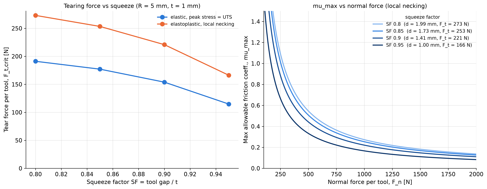
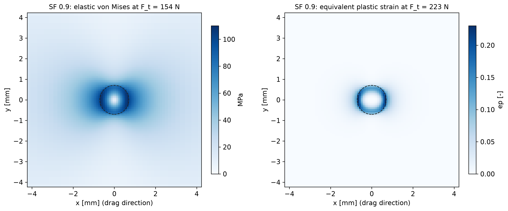

# 01: DSIF friction limit

**Domain:** mechanical
**Tool(s):** Python 3.13 (custom plane-stress FE solver: numpy / scipy / matplotlib)
**Owner:** [@Mthanson1](https://github.com/Mthanson1)
**Status:** in progress

## Goal
Estimate the largest tool/sheet friction coefficient, mu_max, a double-sided incremental
forming (DSIF) setup can tolerate before frictional drag tears the sheet. Express it as a
function of the normal forming force per tool, F_n, so it can be read off once F_n is known.

## Setup
The model is the script itself: [`scripts/dsif_friction_limit.py`](scripts/dsif_friction_limit.py).
**[MODEL.md](MODEL.md) describes it in full:** the physics, contact model, mesh, element
formulation, plasticity algorithm, solver settings and verification status.

- Square sheet 200 × 200 × 1 mm, all edges clamped.
- Two tools, one on each face at the centre, each dragging with in-plane force F_t in +x.
  The mirror symmetry removes bending, which leaves a 2D plane-stress membrane problem.
- Contact patch: a circle whose diameter d comes from the tool tip radius R = 5 mm and the
  squeeze factor SF = tool gap / t (geometric chord). The sheet under the patch is thinned to SF·t.
- Friction traction: Hertzian distribution over the patch.
- Material: AA3003-O (from [`shared/materials/sheet_metals.csv`](../../shared/materials/sheet_metals.csv)).
  J2 plasticity with Swift hardening, fitted to yield 40 MPa, UTS 110 MPa, n = 0.22.
- Mesh: bilinear quads, 16 elements across the patch, graded outward (ratio 1.15).
  Converged to within 0.6 % ([MODEL.md §8.1](MODEL.md#81-mesh-convergence)).
- Tear criteria:
  - *Elastic:* the peak stress reaches the UTS. This is conservative.
  - *Elastoplastic:* the peak equivalent plastic strain reaches the Considère necking strain (local necking).

## Assumptions
- Small-strain membrane theory. It ignores through-thickness shear under the patch and
  stresses from the normal force. The approximation is rough when d/t < 1.5, which applies to SF 0.9 and 0.95.
- A flat sheet with a full circular contact. A real ISF contact sits on an inclined wall,
  so the contact size here is a lower bound.
- Uniaxial Considère necking applied to a multiaxial state. Real ISF formability is usually higher.
- Friction drag = mu · F_n, so mu_max = F_t,crit / F_n is an upper bound.

## How to reproduce
From the repo root, with the venv active (see the top-level README):

```powershell
python mechanical/01-dsif-friction-limit/scripts/dsif_friction_limit.py
```

It takes about 5–8 min for the default four squeeze factors. Run it with `--help` for options
(tool radius, thickness, material, SF list, F_n range, ...). Outputs:

- `results/dsif_mu_vs_Fn.csv`: the mu_max(F_n) table (not committed; regenerate it)
- `results/figures/dsif_mu_vs_Fn.png`
- `results/figures/dsif_friction_limit.png`

Mesh convergence check (about 12 min with 4 parallel workers; `--replot` redraws the figure
from the saved CSV):

```powershell
python mechanical/01-dsif-friction-limit/scripts/mesh_convergence.py
```

Analytic check and domain-size check (seconds and about 8 min respectively):

```powershell
python mechanical/01-dsif-friction-limit/scripts/verification.py kelvin
python mechanical/01-dsif-friction-limit/scripts/verification.py domain
```

## Results
Critical tangential (friction) force per tool, defaults above:

| SF   | d [mm] | t under tool [mm] | F_t elastic [N] | F_t necking [N] |
|------|--------|-------------------|-----------------|-----------------|
| 0.80 | 1.99   | 0.80              | 191.1           | 273.1           |
| 0.85 | 1.73   | 0.85              | 177.1           | 253.4           |
| 0.90 | 1.41   | 0.90              | 153.9           | 220.9           |
| 0.95 | 1.00   | 0.95              | 114.8           | 166.2           |

mu_max (necking criterion). Keep mu **below** these values:

| F_n [N] | SF 0.8 | SF 0.85 | SF 0.9 | SF 0.95 |
|---------|--------|---------|--------|---------|
| 300     | 0.910  | 0.845   | 0.736  | 0.554   |
| 500     | 0.546  | 0.507   | 0.442  | 0.332   |
| 750     | 0.364  | 0.338   | 0.294  | 0.222   |
| 1000    | 0.273  | 0.253   | 0.221  | 0.166   |
| 1500    | 0.182  | 0.169   | 0.147  | 0.111   |
| 2000    | 0.137  | 0.127   | 0.110  | 0.083   |





## Conclusions
- More squeeze (lower SF) gives a larger contact patch, which spreads the drag and raises
  the tear force. Going from SF 0.95 to SF 0.8 raises it by about 65 %.
- Plasticity redistributes stress around the patch. The necking-based tear force is about
  45 % higher than the elastic "peak stress = UTS" estimate.
- Straining concentrates at the leading and trailing edges of the contact, along the drag direction.
- The mesh (`--n_patch 16`) is converged to within 0.6 %, and the elastic FE solution matches
  the analytic Kelvin solution to within 1 % away from the patch
  ([MODEL.md §8](MODEL.md#8-verification-status)).
- Next steps: measure or estimate F_n for the planned toolpaths and read off mu_max.
  Replace the handbook n value with tensile-test data. Check the SF 0.9–0.95 cases with a
  3D solid model (e.g. ANSYS), since membrane theory is weak there.
